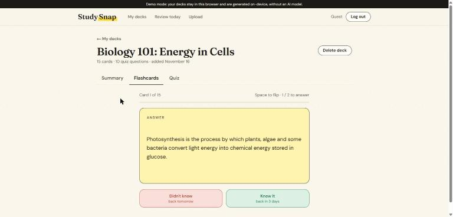
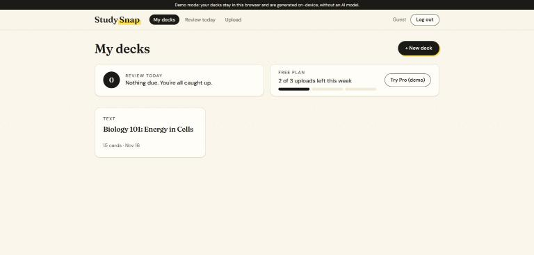
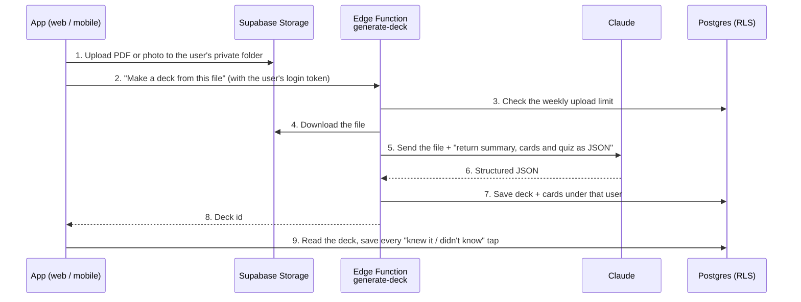

<div align="center">

# 📸 StudySnap

### Your notes in. Flashcards, a summary and a quiz out.

**StudySnap is an AI study buddy for college and high school students.**
Snap a photo of your notebook or upload a lecture PDF, and get everything you need to revise:
a short summary, 10–20 flashcards and a 10-question quiz. It remembers the cards you get wrong and
brings them back at the right time.

### [▶ Try the live demo](https://tirth1263.github.io/StudySnap-AI-Study-Buddy/)


</div>

---

| Flip a card, then tell it how you did | Your decks, today's reviews and weekly uploads |
|---|---|
|  |  |

## Why StudySnap?

Every student knows the feeling: the exam is in three days, the lecture slides are 60 pages long, and
making flashcards by hand would take the whole evening. So most of us skip it and just re-read the
notes, which is one of the least effective ways to study.

StudySnap removes the boring part. You bring the material, it builds the study kit, and a simple
spaced-repetition schedule tells you what to review each day.

## What it does

| | Feature | What you get |
|---|---|---|
| 📄 | **Upload anything** | A lecture PDF, a photo of handwritten notes, or pasted text |
| 🧾 | **Instant summary** | The material in a few sentences, plus the key points |
| 🃏 | **Flashcards** | 10–20 cards. Flip them, then tap **Knew it** or **Didn't know** |
| ✅ | **Quiz** | 10 multiple-choice questions with an explanation after each answer |
| 🔁 | **Review today** | A daily list of the cards that are due, based on what you got wrong |
| 🔐 | **Accounts** | Sign up with email or Google. Your decks are private to you |
| 🎟️ | **Fair usage limit** | Free plan: 3 uploads a week. Pro: unlimited |
| 📱 | **Web and mobile** | A Next.js website and an Expo app sharing one backend and one login |

## The review schedule

Seeing a card again just as you are about to forget it is what makes it stick.

```
Didn't know  ──▶  comes back TOMORROW (and the ladder starts over)
Knew it      ──▶  3 days  ──▶  7 days  ──▶  14 days
```

Every tap is saved, so the **Review today** list is always up to date on every device.
The whole rule lives in one small, readable file:
[`web/src/lib/schedule.ts`](web/src/lib/schedule.ts).

## How it works



In plain words:

1. The app sends the PDF or photo to **Supabase Storage** (a private cloud folder per user).
2. A small server function (**Supabase Edge Function**) hands the file to the AI model. The model reads
   PDFs and photos directly, including handwriting, so there is no separate OCR step.
3. The AI answers in a fixed **JSON** shape (using structured outputs), so the code can always read it.
4. The function saves the cards in the database under that user.
5. The app shows the cards. Each **Knew it / Didn't know** tap is saved so the app knows what to show
   tomorrow.

## Security, in three rules

- **The AI key never leaves the server.** It exists only as a secret on the Edge Function. Anything
  inside an app can be extracted by someone determined, so the apps only ever hold Supabase's public
  "anon" key.
- **Row Level Security on every table.** The database itself enforces "users can only see their own
  rows", so even a modified app cannot read someone else's decks.
- **The server decides what costs money.** Only the Edge Function can create decks, and it checks the
  weekly limit first. The app cannot insert decks directly or change its own plan to Pro.

See the full schema and policies in
[`supabase/migrations/20261116000000_init.sql`](supabase/migrations/20261116000000_init.sql).

## Tech stack

| Layer | Technology |
|---|---|
| Web | Next.js 16 (App Router, static export), React 19, Tailwind CSS 4, TypeScript |
| Mobile | Expo SDK 58, React Native, TypeScript |
| Backend | Supabase: Auth (email + Google), Postgres, Storage, Edge Functions (Deno) |
| AI | Claude via the Anthropic API, with structured JSON outputs |
| Hosting | GitHub Pages, deployed automatically by GitHub Actions |

## Project structure

```
StudySnap-AI-Study-Buddy/
├── web/                      Next.js website (the live demo)
│   └── src/
│       ├── app/              Screens: landing, login, decks, upload, deck, review
│       ├── components/       Flashcard study session, quiz, nav, usage meter
│       └── lib/
│           ├── schedule.ts   The spaced-repetition rule
│           ├── generate.ts   On-device generator used in demo mode
│           └── store/        One interface, two backends: local (demo) and Supabase
├── mobile/                   Expo app: Login, My Decks, Upload, Deck, Review
├── supabase/
│   ├── migrations/           Tables, Row Level Security policies, storage bucket
│   └── functions/
│       └── generate-deck/    The Edge Function that calls the AI
└── .github/workflows/        Builds and publishes the website on every push
```

## About the live demo

The [live site](https://tirth1263.github.io/StudySnap-AI-Study-Buddy/) runs in **demo mode** so that
anyone can try it without an account on a real server:

- Accounts and decks are stored in **your browser only** (localStorage).
- Study material is produced by a small **on-device generator** (keyword and sentence analysis), not by
  an AI model. It reads PDFs with pdf.js and photos with Tesseract OCR, right in the browser.
- Everything else is the real app: the flashcards, the quiz, the review schedule and the weekly limit.

Connect a Supabase project (below) and the same site switches to real accounts and real AI generation.
No page code changes, because every screen talks to a single `Store` interface.

> **Tip:** on the upload screen, click **“Use sample notes”** to see a full deck in a few seconds.

## Run it locally

You need [Node.js 20+](https://nodejs.org).

```bash
git clone https://github.com/tirth1263/StudySnap-AI-Study-Buddy.git
cd StudySnap-AI-Study-Buddy/web
npm install
npm run dev
```

Open <http://localhost:3000>. With no environment variables it starts in demo mode.

## Connect the real backend

### 1. Create a Supabase project

1. Create a project at [supabase.com](https://supabase.com).
2. **Authentication → Providers**: email is on by default. To add Google, enable the Google provider
   and paste in an OAuth client ID and secret from the Google Cloud console.
3. **Authentication → URL Configuration**: add your site URL
   (`https://tirth1263.github.io/StudySnap-AI-Study-Buddy/decks/`) and `studysnap://auth-callback`
   (for the mobile app) to the redirect URLs.

### 2. Create the tables and deploy the function

Install the [Supabase CLI](https://supabase.com/docs/guides/cli), then from the repository root:

```bash
supabase login
supabase link --project-ref YOUR_PROJECT_REF

# Tables, Row Level Security policies and the storage bucket
supabase db push

# The AI key lives here, on the server, and nowhere else
supabase secrets set ANTHROPIC_API_KEY=sk-ant-...

supabase functions deploy generate-deck
```

Get an API key from the [Claude Console](https://console.anthropic.com), and **set a monthly spending
limit there** before you share the app.

### 3. Point the apps at your project

Copy the **Project URL** and **anon public key** from Supabase → Project Settings → API.

**Website (local):** create `web/.env.local`

```bash
NEXT_PUBLIC_SUPABASE_URL=https://YOUR_PROJECT_REF.supabase.co
NEXT_PUBLIC_SUPABASE_ANON_KEY=your-anon-key
```

**Website (deployed):** add the same two names as repository **variables** under
*Settings → Secrets and variables → Actions → Variables*, then re-run the *Deploy web to GitHub Pages*
workflow.

**Mobile:** create `mobile/.env`

```bash
EXPO_PUBLIC_SUPABASE_URL=https://YOUR_PROJECT_REF.supabase.co
EXPO_PUBLIC_SUPABASE_ANON_KEY=your-anon-key
```

```bash
cd mobile
npm install
npx expo start
```

Scan the QR code with the Expo Go app. Google sign-in needs a development build
(`npx expo run:android` or `npx expo run:ios`) because it relies on the app's own URL scheme.

## What it costs to run

| Item | Cost |
|---|---|
| Hosting (GitHub Pages) | Free |
| Supabase | Free tier covers a first batch of users |
| AI per upload | Depends on the model and the size of the file |

The Edge Function uses `claude-opus-5-5` by default for the best-quality cards. To bring the cost per
upload down to a fraction of a cent, switch to the smallest model:

```bash
supabase secrets set ANTHROPIC_MODEL=claude-haiku-5-5
```

The 3-uploads-a-week limit on free accounts is enforced on the server, so one enthusiastic user cannot
run up the bill.

## Roadmap

- [ ] Payments for Pro (monthly, yearly and an exam-season lifetime deal)
- [ ] Edit, add and delete individual cards
- [ ] Study streaks and progress charts
- [ ] Share a deck with classmates
- [ ] Offline review on mobile

## Contributing

Ideas, bug reports and pull requests are welcome. If you are a student, the most useful thing you can
do is try it on your real notes and open an issue describing what the cards got wrong.

## License

[MIT](LICENSE)
